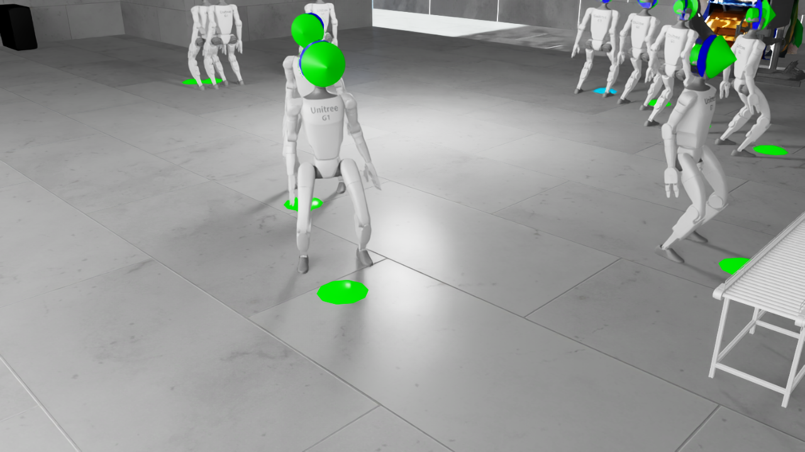
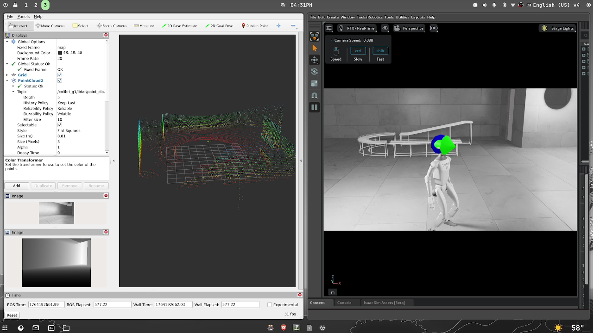

# Colibrí G1: humanoid locomotion with digital twins and reinforcement learning

**M.Sc. thesis, Systems & Computing Engineering, Universidad de los Andes (2026)**
*"Framework for Training and Deployment of Locomotion for Humanoid Robots Based on Digital Twins and Reinforcement Learning"*, Juan Andrés Méndez G.; advisor: Dr. Carlos Andrés Lozano Garzón.

This repo trains a **Unitree G1 humanoid (29 DOF)** to walk to goals with end-to-end **PPO** in **NVIDIA Isaac Lab**, inside a digital twin of the Colivrí lab at Uniandes. It then validates the policy **sim-to-sim over real ROS 2 communication** (the same `/lowstate` / `/lowcmd` topics the physical robot uses) before any hardware deployment.



## Highlights

- **End-to-end goal navigation.** A single policy maps proprioception plus goal position (obs ∈ ℝ¹²⁵) to 29 joint-position targets, with no separate planner or gait layer.
- **87% goal success** over 100 evaluation episodes (within 0.3 m of the goal).
- **Digital twin of the Colivrí lab**, converted from Unity to USD and used as the training and evaluation scene.
- **Communication-realistic sim2sim.** Isaac Sim drives the robot through a ROS 2 Humble / CycloneDDS bridge using Unitree's message types, packaged in Docker with RViz.
- **Exploratory social navigation** with LiDAR (96 rays → 16 sectors) and moving obstacles, documented as an open reward-design problem.

## Results

Base task `Isaac-Colibri-G1-v0`, 100 evaluation episodes (from the paper's evaluation table):

| Metric | Value |
|---|---|
| Goal success (≤ 0.3 m) | **87.0%** |
| Fall rate | 8.2% |
| Final distance to goal | 0.42 ± 0.18 m |
| Mean time to goal | 16.8 s |
| Mean episode reward | 20.48 ± 3.21 |
| Episode length | 921.5 ± 89.4 steps |

Training used 512 parallel environments at 50 Hz on a single RTX 4080 Super with PPO (γ 0.99, λ 0.95, clip 0.2, lr 1e-3).
The social-navigation task reaches only ~1% goal success so far. The thesis analyzes why and treats it as future work.
The sim2sim pipeline is validated end to end at the communication level; quantitative sim-vs-sim comparison and latency characterization are future work.



## Tasks

| Task ID | Purpose | Envs |
|---|---|---|
| `Isaac-Colibri-G1-v0` | Goal-directed locomotion (training) | 512 |
| `Isaac-Colibri-G1-Play-v0` | Visualize / evaluate a trained policy | 10 |
| `Isaac-Colibri-G1-SocialNav-v0` | Goal navigation with LiDAR and moving obstacles | 128 |
| `Isaac-Colibri-G1-SocialNav-Play-v0` | Visualize the social-navigation policy | n/a |

Custom reward terms on top of Isaac Lab's G1 flat-terrain locomotion config: `goal_tracking`, `goal_tracking_fine`, `heading_alignment` and `backwards_penalty`. SocialNav adds `obstacle_proximity_warning`, `obstacle_proximity_critical` and `smooth_trajectory`.

## Repository layout

```
source/digital_twin_colibri_g1/   Isaac Lab extension: tasks, MDP terms (rewards, commands, events), agent configs
scripts/rsl_rl/  scripts/skrl/    train / play entry points (RSL-RL PPO is the main path)
scripts/analysis/                 policy evaluation, TensorBoard export, training-curve plots
sim2sim/  ros2/  cfg/  launch/    Isaac Sim ↔ ROS 2 bridge, Hydra config, launch files
unitree_msgs/  rviz/              Unitree ROS 2 message packages, RViz layout
docker/                           Isaac Sim 4.5 + ROS 2 Humble + Isaac Lab image and compose file
assets/ColibriLab/                USD digital twin of the Colivrí lab
docs/                             thesis and paper LaTeX sources and figures
```

## Getting started

Requirements: NVIDIA GPU, Isaac Sim 4.5 with Isaac Lab 2.2, ROS 2 Humble (for sim2sim).

```bash
# install the extension into your Isaac Lab Python environment
python -m pip install -e source/digital_twin_colibri_g1
python scripts/list_envs.py

# train
python scripts/rsl_rl/train.py --task=Isaac-Colibri-G1-v0 --num_envs 512 --headless
python scripts/rsl_rl/train.py --task=Isaac-Colibri-G1-SocialNav-v0 --num_envs 128 --headless

# watch a trained policy
python scripts/rsl_rl/play.py --task=Isaac-Colibri-G1-Play-v0 --num_envs 10

# evaluate and plot
python scripts/analysis/evaluate_policy.py --task Isaac-Colibri-G1-Play-v0 --checkpoint <path/to/model.pt>
python scripts/analysis/plot_training_curves.py --input_dir <exported_tensorboard_dir>
```

### Sim-to-sim over ROS 2

```bash
# Docker (recommended)
docker-compose -f docker/docker-compose.yaml up isaac_sim_ros2

# or natively
source /opt/ros/humble/setup.bash
export RMW_IMPLEMENTATION=rmw_cyclonedds_cpp
python sim2sim/isaac_colibri_g1_ros2.py
```

The bridge publishes `/lowstate`, `/utlidar/cloud` and front-camera RGB-D, and consumes `/lowcmd` and `/cmd_vel`, mirroring the real G1's interface.

## Related work

- [isaac-go2-ros2 (fork)](https://github.com/jabandersnatch/isaac-go2-ros2): I added Unitree G1 humanoid support (controller, environment, sensors, ROS 2 bridge) to an Isaac Sim / ROS 2 platform for the Go2 quadruped. This was the groundwork for this thesis.

## Citation

```bibtex
@mastersthesis{mendez2026colibri,
  author = {M{\'e}ndez G., Juan Andr{\'e}s},
  title  = {Framework for Training and Deployment of Locomotion for Humanoid Robots
            Based on Digital Twins and Reinforcement Learning},
  school = {Universidad de los Andes},
  year   = {2026}
}
```

## Acknowledgments

Advisor Dr. Carlos Andrés Lozano Garzón; Laboratorio Colivrí and the Department of Systems & Computing Engineering, Universidad de los Andes. Built on [Isaac Lab](https://github.com/isaac-sim/IsaacLab) (G1 locomotion and PPO configs), [RSL-RL](https://github.com/leggedrobotics/rsl_rl) and Unitree's ROS 2 interfaces.
